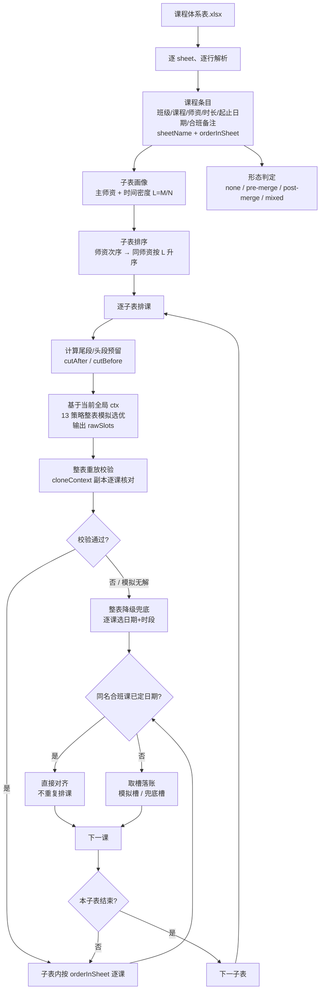

# 课程体系表子表排课流程梳理

> 适用范围：课程体系表（一个 Excel 多个 sheet）→ 逐子表排课 → 生成课程日期与时段。
> 对应实现：`app/src/scheduler/`、`app/src/utils/excelParser.js`、`app/src/utils/sheetForm.js`。

## 0. 一句话结论

每张子表的排课内容由六层生成：

**Excel 行 → 课程条目 → 子表画像 → 子表排序 → 13 策略整表模拟选优 → 整表重放校验与逐课落账**。

子表内部靠 **行序递增链 + 日期预算 + 合班课前后的预留/截断/上下界** 保证前后课程相关；
子表之间靠 **全局师资/班级占用 + 同名合班课日期对齐 + 子表排序** 保证前后子表相关。

---

## 1. 总体链路



---

## 2. 内容如何生成

### 2.1 第一层：课程条目（Excel 行 → 结构化数据）

解析时每个 sheet 独立处理，每个有效行生成一条课程记录：

| 字段 | 生成规则 |
|---|---|
| `classType` | 固定取每个子表 **A 列**；规范化后按标准班级名归类，未识别则保留原值并告警 |
| `courseName` | 按表头关键字「课程名称 / 课程名 / 课程」定位 |
| `teacher` | 按表头关键字「师资 / 老师 / 姓名 / 教师」定位 |
| `duration` | 按表头关键字「时长 / 课时 / 时间」定位 |
| `startDate` / `endDate` | 可选列；填写后该课只允许在此区间内排课，未填则不限 |
| `mergeNote` | 可选列「合班备注 / 备注」 |
| `sheetIndex` / `sheetName` | 来源子表 |
| `orderInSheet` | 行号 − 1，**子表内一切顺序的唯一依据** |
| `scheduled` | 每次排课前统一重置为 `false` |

补充规则：

- 只有「班级 + 课程名称 + 师资 + 时长」都非空的行才会进入排课。
- 班型含中英文逗号（如 `27OMO,28OMO`）表示多个班级一起上课，仍是一条课程记录，排课时需同时满足所有班级空闲。
- **合班课识别**：`mergeNote` 含「合班」，或班型包含多个班级。

### 2.2 第二层：子表画像

对每张子表计算两个画像指标：

1. **主师资**：子表内课程条数最多的师资；条数相同取师资理论排课次序更靠前者。
2. **时间密度 `L = M / N`**：
   - `N` = 子表课程总数；
   - `M` = 同时填写了起止日期的行中，`最晚终止日期 − 最早起始日期 + 1 天`；
   - 全部缺日期时 `L = ∞`。

`L` 越小，表示单位课程可用的天数越少、排课越紧张，越应优先排。

### 2.3 第三层：子表排序（决定“谁先排”）

排序分两步：

1. **师资次序**：
   - 先按科目：英语 > 政治 > 数学 > 408计算机 > 日语 > 未收录科目；
   - 同科目内按难易程度降序：`难易程度 = 该师资课程总时长 ÷ 空闲总时长`，无空闲为 `∞`，最优先。
2. **子表次序**：
   - 按主师资的师资次序分组；
   - 同一主师资下，按 `L` 升序；
   - `L` 相同按课程数降序；
   - 再相同按子表出现顺序；
   - 无主师资的子表兜底排最后。

> 这个顺序不仅影响“先排谁”，还决定同名合班课由哪张子表先确定日期（见 3.4）。

### 2.4 第四层：13 种策略模拟与整表方案选优（每张子表排课前即时生成，v6.0）

v6.0 起，本层不再只产出“偏好锚点”，而是直接产出该子表的**整表排课方案**：13 种策略各把整张子表模拟一遍，评分选优后得到每门课的“日期 + 起止时段”（`rawSlots`）。该方案经 2.5 整表重放校验通过后，**即作为最终排课结果逐课落账**，2.5 不再重新枚举日期和时段。

模拟上下文 `simCtx` 是当前全局占用账本 `ctx` 的深拷贝，模拟过程中逐课 `registerSlot`，**不写回全局 `ctx`**；因此 13 种策略互不影响，也不改变主流程的占用状态。

**第一步：逐门课生成候选池**

- 用 `teacher + classType` 构建师资-班级空闲表；
- 依次扣除师资占用、班级占用、头/尾段预留、`cutAfter` / `cutBefore`；
- 取剩余碎片的日期去重，再按该课起止区间过滤，得到该课候选日期池。

口径说明：

- 合班课合并所有组成班级的占用，任一班级冲突即该时段不可用；
- 日期层使用“基线日期池”：已扣先前子表占用，尚未扣同表模拟课；槽位层再扣同表前面模拟课，逐课收紧；
- 子表级“师资空闲日期并集”只用于空池快速判断和无课程明细时的兜底合成，**不是**正式候选池。

**第二步：执行 13 种策略模拟**

- 输入为当前全局排课上下文（占用账本，含先前子表占用）；本子表预留/截断在构建空闲表时叠加。
- 策略只决定“在池内怎么挑”，候选边界始终是每门课自己的师资-班级空闲池；任一课池为空，该策略即不可行。
- 每种策略输出完整的“日期 + 起止时段”序列：
  - 日期层：均匀铺开 / 月初前载 / 月末后载 / 月中向两边分散 / 贪心启发式，可叠加“晚间日期偏好”“周末偏好”；
  - 时段层：晚间优先 / 时间分最高 / 日间优先 / 奇偶交替 / 最早时段；
  - 阶段三：对时间分未满的槽，在前后 2 天寻找更优时段；
  - 阶段四：多课变体组合，按总分选最优分支。

**第三步：评分选优**

- 设可行区间 `[X1, X2]`、自由课数 `Y`，理想节奏 `Z = round((X2 − X1 − 1 − Y) / Y)`；
- 评分 = 起始留白 + 终止留白 + 相邻间隔匹配（按偏差线性衰减）+ 均匀度 + 覆盖范围 + 中间覆盖奖励 + 槽位时间优先级均值；
- 最高分策略的槽位按课程顺序一一对应，构成本子表的最终方案 `rawSlots`（同时输出逐课明细 `steps`：日期、起止时段、时间分、是否固定槽）；
- **v6.0**：`rawSlots` 不再只是每门课的 `preferredSlot` 偏好，而是待 2.5 校验、通过后直接落账的最终结果。

**两个特殊处理**

- **已定日期合班课**：作为固定槽硬约束，不参与模拟与评分；只模拟自由课，再映射回全量索引（固定槽同样占位，保证序号对齐）。
- **锚点校正**（legacy / 兜底专用）：锚点超出该课起止区间时，就近映射到“该课区间 ∩ 该师资可用日期”，并清空时段，只保留日期锚点。v6.0 起校正结果 `correctedSlots` 只服务 legacy 模式的逐课偏好与降级兜底；simulation-first 的校验与落账一律使用未校正的 `rawSlots`。

### 2.5 第五层：整表重放校验与逐课落账（v6.0）

子表内仍严格按 `orderInSheet` 逐课处理，但正常路径不再“逐课选日期 + 时段”，而是消费 2.4 的整表方案：先整表重放校验，通过后按序取槽落账；只有校验失败或模拟无解时，才整表降级为逐课兜底。

**第一步：整表重放校验**

在 `cloneContext(ctx)` 得到的副本上，按课程顺序重放 2.4 的 `rawSlots`，逐课校验：

- 槽位完整（日期 + 起止时段均存在）；
- 课程自身起止区间；
- 同班日期链严格递增（`prevDate`）；
- 合班课上下界：先分后合的上界 `latestDate`、先合后分的下界 `earliestDate`；
- 时段落在该课当时的师资-班级空闲碎片内（口径同下面“兜底”的空闲表构建）；
- 与已排课程无冲突（同师资 + 同班每天至多一节、时段重叠、`MIN_GAP` / `CLASS_MIN_GAP` 间隔、科目互斥）。

已定日期的合班课跳过校验，只推进班级日期链。校验过程只读，不写全局 `ctx`；结果写入 `diagnostics.sheetStats[].planValidation`（`verified` / `reason` / `strategy`）。

**第二步：校验通过 → 模拟槽位直接落账**

- 第 `i` 门课直接取 `rawSlots[i]`（已定日期合班课同样占位，保证序号对齐）；
- 标记 `slotSource = 'simulation'`，不调用 `scheduleCourse`，不再枚举候选日期与时段；
- `commitSlot` 注册师资/班级占用、写入课程结果、标记 `scheduled = true`，并推进同班日期链；
- 若为合班课，同时写入“已定日期合班课表”（`课程名称|规范化班型 → 日期/时段/来源子表`）；后续子表同名合班课直接对齐（`aligned`），不重复落账。

**第三步：校验失败 / 模拟无解 → 整表降级兜底**

触发条件：13 种策略全部模拟无解，或整表重放校验不通过（原因记入 `planValidation.reason`）。此时该子表逐课调用 `scheduleCourse`，恢复完整的逐课选取流程：

1. **构建师资-班级空闲表**：从该师资原始空闲时间出发，依次扣除合班课截断 `cutAfter` / `cutBefore`、同班级已排时段（前后缓冲 `X`，默认 5 分钟）、同师资已排时段（前后缓冲 `Y`，默认 30 分钟）、头段/尾段预留日期内“合班课其他班级”的已排时段，得到按天切片的可用时段碎片。
2. **收缩日期窗口**：先剔除已排满的日期，再叠加课程起止区间、同班上一课日期 `prevDate`、合班课上界 `latestDate` / 下界 `earliestDate`、日期预算（后续同师资课程要留够可用日期）。
3. **枚举时段槽**：以 5 分钟为步长枚举能放下课时长的时段，逐个校验同师资 + 同班每天至多一节、`MIN_GAP = 10`、`CLASS_MIN_GAP = 5`、科目互斥。
4. **评分选优**：在每个候选日期上取最高分时段，再横向比较：

```text
score = 时间优先级 × 3
      + 锚点奖励 × 10
      + 日期递增奖励 × 5
      - 晚间守护惩罚
      + 锚点槽位全等奖励 10000
```

- 锚点奖励：同日 100，差 1 天 70，≤3 天 50，≤7 天 30，否则 10；
- 锚点日放不下晚间时段时，锚定奖励降为 10，允许转向邻日晚间；
- 锚点日只能排白天、而系统中存在晚间候选时，罚 500 分；
- 日期递增：同师资上一课之后，间隔 3 天奖励最高；合班课“尽早优先”时，间隔 2 天最高；
- 锚点日期与起止时段完全一致时 +10000，直接锁定模拟槽位。

5. **失败补排**：正常排课无解时，改用该师资原始空闲时间重试一次（仍走全部硬约束与评分）；仍失败则该课 `scheduled = false`。

兜底成功的课程标记 `slotSource = 'fallback'`，报告会同时给出降级原因。

**第四步：落账**

模拟落账与兜底落账口径一致：注册占用、写课程结果、标记 `scheduled`、推进同班日期链；合班课写入合班课表供后续子表对齐。

**模式开关**

`generateSchedule(state, { scheduleMode })` 支持两种模式：

- `simulation-first`（默认）：2.4 模拟选优 → 2.5 整表校验 → 直接落账；
- `legacy`：2.4 方案仅作 `preferredSlot` 偏好，2.5 逐课评分选槽（上表 +10000 全等奖励生效）。

一句话概括：**2.4 一次性选出整表的日期 + 时段，2.5 只做整表校验与逐课落账；只有校验不通过或模拟无解时，才退回逐课重选。**

### 2.6 第六层：结果输出

- `courses`：实际新排的课程（合班课只显示一次）。
- `courseSystemData`：所有行回写 `scheduled`，对齐的合班课也标记为已排。
- `successCount` 按“已排课行数”统计，包含对齐课，因此可能大于 `courses` 条数。
- `scheduleTrace` 记录排课模式（`mode`）、逐课决策轨迹（`slotSource` = `simulation` / `fallback` / `aligned`）与各子表第一课的空闲表快照。
- `diagnostics` 记录 `scheduleMode`，以及各子表的 `planValidation`（模拟方案是否通过整表校验、降级原因、选中策略）。
- 管线再把 `scheduled` 回写到课程体系文件，并生成排课报告（报告月份取课程体系最早起始日期所在月）。

### 2.7 师资-班级空闲表与子表排课的关系

课程体系表与师资-班级空闲表是排课的两侧：

- **课程体系表 = 需求侧**：规定“哪张子表、第几行、哪个班级、哪位师资、上多久、允许在哪段日期内上”。
- **师资空闲表 = 供给侧**：上传的原始数据，规定“每位师资哪些日期、哪些时段可上课”。
- **师资-班级空闲表 = 匹配时的实际可用域**：在师资空闲表基础上，扣除该班级与该师资已被占用的时段，以及本子表的预留/截断后得到的碎片集合。

> 术语区分：**师资空闲表**是上传的原始数据，只有师资维度；**师资-班级空闲表**是逐课派生的结果，已扣除班级占用、师资占用、预留与截断。下文所说的“候选日期池 / 排课边界”一律指后者。

它不是上传的原始文件，而是**每排一门课即时计算**出来的中间结果：

```text
某课可用碎片
= 该师资原始空闲
− cutAfter / cutBefore 截断
− 同班级已排课程（前后各 X 分钟）
− 同师资已排课程（前后各 Y 分钟）
− 头段/尾段预留日期内“合班课其他班级”的已排课程
```

两者的关系可以概括为四点：

1. **课程体系表决定“向哪张空闲表要时间”**
   每门课用 `teacher` 取该师资的空闲，用 `classType` 取该班级的已占时段；合班课会合并所有组成班级的占用。

2. **空闲表决定“这门课能不能排、能排在哪”**
   空闲碎片的日期去重就是该课的候选日期池；池为空 → 直接失败；池内再按课程区间、行序下界、合班课上下界、日期预算过滤。v6.0 正常路径下，日期与时段由第四层的整表模拟一次选出；只有在模拟方案校验失败或 13 策略全无解、退回逐课兜底时，才在剩余碎片里重新枚举时段槽。

3. **每排成功一门课，就改写后续课程的师资-班级空闲表**
   落账时把该时段注册进全局 `ctx`，下一门课重新构建空闲表时就会扣掉它。这就是“前后内容相关性”在数据层面的实现：
   - 同师资的后续课避开该时段；
   - 同班级的后续课避开该时段；
   - 合班课会同时占用多个班级；
   - 已排课表（preset）也会提前写入占用。

4. **子表级约束都是对这张空闲表的加工**
   - 尾段/头段预留：在指定日期范围内追加“其他班级”的占用；
   - `cutAfter` / `cutBefore`：直接裁掉合班课之后/之前的整段时间域；
   - 缓冲 X/Y：控制扣除时前后多留多少分钟；
   - 科目互斥：决定同班级的哪些已排课程需要扣除。

另外，13 种策略的整表模拟也建立在同一张“当前空闲表”之上：模拟使用 `ctx` 的深拷贝，并逐课构建师资-班级空闲表。v6.0 起，模拟选出的方案在真实 `ctx` 上整表重放校验通过后即作为最终排课结果逐课落账；只有校验失败或模拟无解时，才退回逐课构建空闲表重新选取。

一句话：**课程体系表给出排课顺序与约束，师资空闲表给出原始可用时间，师资-班级空闲表是两者逐课匹配时的“实时余量”；排课过程就是不断从这张余量表中取走时段并回写占用的过程。**

### 2.8 第四层（13 策略整表模拟）与第五层（校验与落账）的关系

两层是**“整表一次性选优”与“整表校验 + 逐课落账”**的关系。v6.0 起，正常路径只有第四层负责选取日期和时段，第五层不再重复选取。

| 维度 | 第四层：13 策略整表模拟 | 第五层：整表校验与落账 |
|---|---|---|
| 作用范围 | 整张子表，13 种策略各模拟一遍 | 整表校验，落账按 `orderInSheet` 逐课执行 |
| 输出 | `rawSlots`（每门课的日期 + 起止时段） | 最终课程结果、占用账本、`scheduled` |
| 性质 | **选取与评分** | **校验与执行**（正常路径不选取） |
| 目标 | 整表均匀分散、晚间优先、避免前松后紧 | 确认方案在真实 `ctx` 下仍可行，并逐课落账 |
| 失败影响 | 13 策略全不可行 → 无方案，整表降级兜底 | 校验不通过 → 整表降级兜底；兜底单课失败只影响该课 |

具体衔接方式：

1. **同源输入，保证方案“原则上可行”**
   - 第四层对每门课用 `teacher + classType` 构建师资-班级空闲表：从该师资原始空闲出发，依次扣除
     - `cutAfter` / `cutBefore`：已定日期合班课开始前/结束后的整段时间域；
     - 班级占用：本课涉及班级（合班课取并集）在 `classScheduleByDate` 中的已排课程，前后各留 `X = 5` 分钟；
     - 师资占用：该师资在 `teacherScheduleByDate` 中当天的已排课程，前后各留 `Y = 30` 分钟；
     - 头/尾段预留：预留日期内「合班课其他班级」的已排课程（本课班级自身不重复扣除）。
   - 占用来源包括：先前子表已落账的课程、本子表前面已落账的课程、已排课表（preset）。preset 按「班级 + 师资」双维度登记，科目由 `inferPresetSubject` 推断后参与互斥判定；它不写「师资 + 班级每天一节」计数，因此只做时间窗互斥，不触发每日一节硬约束。
   - 科目互斥口径有差异：preset 用严格 `isSubjectConflict`（未识别科目全互斥）；普通已排课用 `isAvailabilityClassConflict`（如日语不扣同班英语/408计算机）。本子表内尚未落账的合班课不通过班级占用扣除，而由 `cutAfter`/`cutBefore` 与模拟固定槽约束。
   - 模拟上下文 `simCtx` 是排到该子表时 `ctx` 的深拷贝，并同样应用尾段/头段预留、`cutAfter`/`cutBefore`；
   - 日期层使用基线池（已扣先前子表占用），槽位层使用累积 `simCtx`（再扣同表前面模拟课）；
   - 因此模拟出的槽位不会落在该课已知不可用的日期，也不会违反已定日期合班课的固定槽。

2. **第五层做的是重放校验，不是第二次选取**
   - 在 `cloneContext(ctx)` 副本上按行序重放 `rawSlots`，逐课校验区间、班级递增链、合班课上下界、师资-班级空闲碎片与冲突；
   - 校验通过后第 `i` 门课直接取 `rawSlots[i]` 落账，`slotSource = 'simulation'`，不调用 `scheduleCourse`、不枚举候选时段；
   - 已定日期的合班课同样占一个槽位序号，对齐时消耗序号，防止后续普通课“取错槽”。

3. **模拟可行 ≠ 最终一定可用**
   - 真实 `ctx` 可能已被同表前序课程改变占用，或预留/截断的实际口径与模拟时不同；
   - 一旦校验失败，**整表**降级为逐课兜底，原因写入 `planValidation.reason`，不在模拟方案上做局部修补；
   - 逐课兜底时才恢复“构建空闲表 → 收缩日期窗口 → 枚举时段 → 评分选优 → 失败补排”的旧流程。

4. **硬约束在校验阶段集中裁决**
   课程自身起止区间、`prevDate` 下界、`latestDate`/`earliestDate` 合班课上下界、日期预算、同师资/同班级每日一节、时段间隔、科目互斥，任一不满足都会使整表校验失败，模拟分数再高也不能突破。

5. **legacy 模式保留旧口径**
   - `scheduleMode = 'legacy'` 时，第四层方案仅作为 `preferredSlot` 偏好，第五层逐课评分选槽（锚点槽位全等 `+10000` 锁定）；
   - 锚点校正（把区间外锚点就近映射到课程区间内）只服务 legacy 路径与降级兜底，simulation-first 使用未校正的 `rawSlots`。

6. **反馈是“跨子表”而非“子表内”**
   - 同一张子表的方案在排课前一次生成，子表内落账**不会重新生成方案**；
   - 实际落账产生的占用会写回 `ctx`，影响的是**下一张子表**的第四层模拟；
   - 跨子表通过 `ctx` 实现“前表排完后表重算”。

一句话：**第四层回答“这张子表整体应该怎么铺”，第五层回答“这个方案现在还能不能落地”；能落地就直接执行，不能落地整表退回逐课兜底。**

---

## 3. 前后内容的相关性（重点）

### 3.1 子表内：行序递增链

- 子表内课程**严格按行序**逐门排，后一门一定在前一门之后处理。
- 按班级维护“上一门课日期”，当前课的下界取其所涉及班级中的**最晚日期**。
- 合班课会同时推进所有组成班级的日期链。
- 日期链**只进不退**：即使后续课排到更早日期，也不会把班级链回退。
- 日期窗口允许同日，但“同师资 + 同班级每天至多一节”会把同师资链条实际推到后一天；不同师资的同班课程可在同日不同时段并存（仍受班级间隔与科目互斥约束）。

作用：保证同一张子表内，课程内容顺序与时间顺序一致，不会出现“后面的课排到前面”。

### 3.2 子表内：日期预算（为后续课程留日期）

排当前课时，会统计本子表内**后续同师资、且排课区间与本课有交集**的课程数量，形成 `reserveAfter`。

- 若某候选日期之后的可用日期数不足以容纳后续课程，则该日期被禁用。
- 已在先前子表确定日期的合班课只做对齐、不占新日期，因此不计入预算。
- 区间完全错开的课程不计入，避免紧区间课程被“误伤”。

作用：防止前面的课把日期用光，导致后面的同师资课程无日期可排。

### 3.3 子表内：普通课与合班课的前后关系

先按行序判定子表形态，再施加不同约束：

| 形态 | 判定（按行序） | 预留 | 截断 | 日期界 |
|---|---|---|---|---|
| `none` | 无合班课 | 无 | 无 | 无 |
| `pre-merge`（先分后合） | 首个合班课之前有普通课，末个合班课之后没有普通课 | **尾段预留** | **cutAfter** | **上界** `latestDate` |
| `post-merge`（先合后分） | 末个合班课之后有普通课，首个合班课之前没有普通课 | **头段预留** | **cutBefore** | **下界** `earliestDate` |
| `mixed` | 合班课前后都有普通课 | — | — | 整表跳过并报错 |

具体机制：

- **尾段/头段预留**
  - 比例 `N = 合班课数 ÷ 子表总课数 × 130%`；
  - 天数 `= round(当月天数 × N)`，至少 1 天、至多当月天数 − 1；
  - 先分后合预留月末尾段，先合后分预留月初头段；
  - 在该日期范围内，把“合班课其他班级”的已排时间也扣除，避免普通课占用需要多班同时空闲的日期。
- **截断**
  - `cutAfter`：删除第一个“已定日期合班课”开始时间 − 5 分钟之后的全部空闲；
  - `cutBefore`：删除最后一个“已定日期合班课”结束时间 + 5 分钟之前的全部空闲；
  - 仅当合班课日期在本子表排课前**已经确定**（由先前子表确定）才生效；
  - 合班课行自身不受截断约束；本子表首次确定日期的合班课也不会被截断排死。
- **日期上下界**
  - 先分后合：位于已定日期合班课之前的普通课，最晚排到合班课日期前一天；
  - 先合后分：位于已定日期合班课之后的普通课，最早从合班课日期后一天开始。

作用：让普通课与合班课在时间上形成“先分后合”或“先合后分”的正确前后段，而不是互相挤占。

### 3.4 跨子表：全局占用与同名合班课对齐

跨子表相关性有三条主线：

1. **全局排课上下文 `ctx`**
   - 记录每个师资每天已占时段；
   - 记录每个班级每天已占时段（合班课按组成班级逐个注册）；
   - 记录“师资 + 班级 + 日期”已排节数（保证每天至多一节）；
   - 后续子表生成空闲表时，会扣掉这些占用，因此**前一张子表排过的课会真实影响后一张子表**。
   - 科目口径：日语只扣同班政治/数学，不扣英语/408计算机；未知科目保守全互斥。

2. **同名合班课日期对齐**
   - 对齐键：`课程名称 | 规范化班型`；
   - 先排到的子表确定日期与时段，写入“已定日期合班课表”；
   - 后续子表遇到同一门合班课：直接标记 `scheduled = true` 并对齐该日期，**不重复排课、不重复注册占用、不重复写入课程结果**；
   - 对齐课仍会推进相关班级的日期链，并消耗一个方案槽位序号，保证后续普通课取到正确槽位。

3. **子表顺序决定“谁先定日期”**
   - 师资难易程度 + 子表时间密度 `L` 决定先排哪张子表；
   - 先排的子表确定合班课日期，后排的子表只能对齐，因此排序会间接决定合班课的最终日期。
   - 注意：跨子表只做“同名合班课对齐”，**不再做按班级的跨表日期推进**；不同名课程之间仅通过师资/班级占用间接相关。

### 3.5 跨子表：整表方案与前序排课的耦合

- 每张子表的整表方案不是一次性全局预生成，而是在**轮到该子表时**基于当前 `ctx` 重新模拟选优。
- 因此方案天然避开先前子表已经占用的师资/班级时段。
- 已定日期合班课作为固定槽参与方案占位，保证“模拟方案”与“最终排课”同源；方案校验通过后直接落账，不再二次选取。

### 3.6 已排课表（preset）的跨科目占用

若上传了“已排课表”，会在排课前预注册：

- 班级维度：同一班级同一时间段只能上一门课；
- 师资维度：同一师资同一时间段不能上两门课；
- 科目按授课师资推断，参与科目互斥判断；
- 刻意不触发“每天至多一节”，只做时间窗互斥。

作用：让本次排课与历史已排课程在时间上不冲突，但不改变本次课程体系的行序逻辑。

---

## 4. 按子表形态的排课流程差异

### 4.1 无合班课子表（`none`）

1. 解析行 → 计算主师资与 `L`。
2. 按师资次序 + `L` 决定子表顺序。
3. 基于当前全局 `ctx` 的深拷贝做 13 策略整表模拟，选出总分最高的方案（`rawSlots`：每门课的日期 + 起止时段）。
4. 在真实 `ctx` 副本上整表重放校验；通过后逐课取 `rawSlots[i]` 落账并推进班级日期链。
5. 校验不通过或 13 策略全无解时，整表降级为逐课兜底：日期窗口 = 课程区间 + 同班上一课日期 + 日期预算，枚举时段槽评分选槽，失败补排。

### 4.2 先分后合子表（`pre-merge`）

1. 识别首个/末个合班课，确认普通课都在合班课之前。
2. 若合班课日期尚未确定：
   - 计算尾段预留（月末 N 天），扣除合班课其他班级在尾段的已排时间；
   - 整表模拟时把普通课往合班课之前引导（尾段预留 + 普通课 `latestDate`）；
   - 按方案逐课落账：先按行序落普通课，最后落合班课并确定其日期。
3. 若合班课日期已由先前子表确定：
   - `cutAfter` 把第一个合班课开始时间之后的空闲全部删除；
   - 普通课上界 `latestDate` = 合班课日期 − 1；
   - 合班课行直接对齐，不重新排，但仍消耗一个方案槽位序号。
4. 方案校验不通过或模拟无解时，整表降级逐课兜底，规则同上。

### 4.3 先合后分子表（`post-merge`）

1. 识别首个/末个合班课，确认普通课都在合班课之后。
2. 若合班课日期尚未确定：
   - 计算头段预留（月初 N 天），扣除合班课其他班级在头段的已排时间；
   - 整表模拟时先固定合班课槽位，再在其后铺后续普通课；
   - 按方案逐课落账：先落合班课并确定日期，再落后续普通课。
3. 若合班课日期已由先前子表确定：
   - `cutBefore` 把最后一个合班课结束时间之前的空闲全部删除；
   - 普通课下界 `earliestDate` = 合班课日期 + 1；
   - 合班课行直接对齐，但仍消耗一个方案槽位序号。
4. 方案校验不通过或模拟无解时，整表降级逐课兜底，规则同上。

### 4.4 混合形态子表（`mixed`）

- 判定条件：首个合班课之前有普通课，且末个合班课之后也有普通课。
- 处理方式：**整张子表跳过排课**，所有课程保持未排；
- 同时写入诊断信息（合班课数、前后普通课数、原因），排课报告与上传页标红提示；
- 建议拆分该子表或调整行序，使其变为纯“先分后合”或“先合后分”。

---

## 5. 失败与兜底

| 阶段 | 失败情形 | 处理 |
|---|---|---|
| 子表形态 | `mixed` | 整表跳过，记录诊断 |
| 空闲表 | 师资-班级空闲表为空 | 模拟无解，该课在该路径直接失败 |
| 整表模拟 | 13 策略全部不可行 | 无 `rawSlots`，整表降级为逐课兜底 |
| 整表校验 | 重放 `rawSlots` 任一硬约束不满足 | 整表降级为逐课兜底，原因写入 `planValidation.reason` |
| 逐课兜底 | 日期窗口内无可行槽 | 进入补排 |
| 补排 | 用原始师资空闲时间仍无可行槽 | 该课 `scheduled = false` |
| 合班对齐 | 同名合班课已在先前子表定日期 | 直接对齐，不再排课，仍消耗方案槽位序号 |

失败课程不会中断子表或后续子表；统计时计入 `failedCount`。

---

## 6. 关键参数速查

| 参数 | 默认值 | 含义 |
|---|---|---|
| `MIN_GAP` | 10 分钟 | 同师资课程最小间隔 |
| `CLASS_MIN_GAP` | 5 分钟 | 同班级课程最小间隔 |
| `AVAIL_REMOVE_PAD`（X） | 5 分钟 | 班级占用/预留/截断的缓冲 |
| `AVAIL_REMOVE_PAD_TEACHER`（Y） | 30 分钟 | 师资占用扣除缓冲 |
| 时间优先级 | 19:00 = 300 最高 | 晚间 > 下午 > 上午 |
| 锚点奖励权重 | ×10 | 仅 legacy / 逐课兜底评分生效：保持整表分散骨架 |
| 日期递增权重 | ×5 | 维持行序与递增 |
| 时间优先级权重 | ×3 | 晚间优先 |
| 锚点槽位全等 | +10000 | 仅 legacy 模式生效：锁定模拟方案槽位 |
| 尾/头段比例 | 合班占比 × 130% | 为合班课预留日期段 |
| 分散策略数 | 13 | 模拟后取总分最高（分散基础分 + `timeScoreAvg`） |

---

## 7. 代码位置索引

- 课程体系表解析：`app/src/utils/excelParser.js`
- 合班识别与子表形态：`app/src/utils/sheetForm.js`
- 排课编排（子表排序、13 策略整表模拟调度、整表重放校验、逐课落账/兜底、合班对齐）：`app/src/scheduler/index.js`
- 全局上下文、冲突检测、空闲表扣除与截断、`cloneContext` / `slotWithinAvailability`：`app/src/scheduler/scheduleContext.js`
- 单课候选槽评分（legacy / 兜底路径）：`app/src/scheduler/trySchedule.js`
- 13 策略模拟、整表评分与 `rawSlots` / `steps` 输出：`app/src/scheduler/dispersion.js`
- 时间优先级：`app/src/scheduler/timePriority.js`
- 参数常量：`app/src/scheduler/constants.js`、`app/src/config/constants.js`
- 排课管线与报告（模式、模拟方案校验、落账来源展示）：`app/src/scheduler/pipeline.js`、`app/src/scheduler/report.js`
